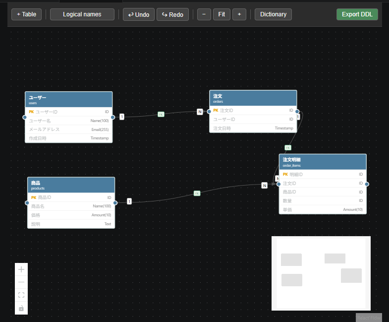

# markdown-er

**VSCode extension — Interactive ER diagram editor backed by plain `.ermd` files.**



---

## Overview

`markdown-er` lets you design and maintain ER diagrams entirely inside VSCode.  
The diagram is stored in a `.ermd` file (with `er-diagram: true` in the front matter), so it is **human-readable, diffable, and version-control friendly** — no proprietary binary format, no separate toolchain.

---

## Features

| Feature | Details |
|---|---|
| **Interactive canvas** | Drag tables to reposition, resize with handles, pan & zoom |
| **Column-type dictionary** | Define reusable DB types (e.g. `UserID → INT`, `Name → VARCHAR(100)`) and apply them to columns |
| **Logical / Physical names** | Every table and column carries both a logical name (e.g. `ユーザー`) and a physical name (e.g. `users`). Toggle the view with one click. |
| **Relations** | Drag from one table to another to create a relation. Click the relation to set cardinality (1:1 / 1:N / N:N) and optionally add a FK constraint. |
| **Region group boxes** | Group related tables with a labeled background rectangle |
| **Undo / Redo** | Full history via `Ctrl+Z` / `Ctrl+Y` |
| **SQL import** | Paste or open DDL and `INSERT` statements (also `mysqldump` / `pg_dump` output) to add tables, relations, indexes and seed data. A preview lists what will be imported and anything that can't be |
| **Test tables and data** | Mark a table as test-only and give production tables test rows. They are kept in `<file>.ermd.test.yaml`, stay out of the production DDL, and get their own **Test DDL** |
| **Auto-save** | Every change, including positions and viewport, is written to the `.ermd` file within about a second. The toolbar shows **Saving… / Saved / Save failed**; `Ctrl+S` saves right away |
| **DDL export** | Export full `CREATE TABLE` DDL, or diff-only `ALTER TABLE` statements against a git baseline. Plain `CREATE TABLE` by default; comments, table options, explicit `NULL` and identifier quoting are switchable. **Save DDL…** / **Save data…** write `.sql` files. **Replacements** adjust the output with your own find / replace rules |
| **Column list** | Type, size, PK, auto-increment and NULL side by side; comment, default value and design note under **Details** |
| **Seed data editor** | Enter initial rows for each table in a spreadsheet-like editor. Leave the auto-increment key empty to let the database generate it. Data is saved in the `.ermd` file and is git-diffable |
| **INSERT export** | Optionally include seed data as `INSERT INTO` statements in the DDL output |
| **Auto Layout** | Arrange all tables automatically — Vertical, Horizontal, or Auto. Undo-able with `Ctrl+Z` |
| **Database dialect** | Choose MySQL, PostgreSQL, Oracle, SQL Server, or SQLite in Settings |
| **Database / schema / user** | Set the database name, schema, application user, character set and collation; optionally emit `CREATE DATABASE` / `CREATE USER` / `CREATE SCHEMA` with the DDL |
| **English / 日本語 UI** | Switch the editor language from the toolbar (or follow the VSCode display language) |
| **Minimap toggle** | Show or hide the minimap with the Minimap button in the toolbar |
| **Schema versioning** | Save named snapshots of the schema inside the `.ermd` file; generate `ALTER TABLE` DDL between any two versions — no git commit required |
| **CSV import** | Import tables and columns (or dictionary entries) from a CSV file via the **Import CSV** button in the toolbar |
| **Type picker** | Pick a column type from the dictionary or from basic types (both grouped by category), type `varchar(50)` directly, or register a new dictionary type inline |
| **Column sets** | Define common columns once (e.g. version, created / updated at and by) and add them to tables; changes reach every table using the set |

---

## Getting started

> **v0.x note:** This project is in early development. The `.ermd` file schema (YAML block structure, field names) may receive **breaking changes** in future versions before a stable 1.0 release. Back up or version-control your `.ermd` files if you rely on them long-term.

### Install

Search for **"Markdown ER Diagram"** in the VSCode Extensions panel and click **Install**.

#### Build from source

```bash
git clone https://github.com/Nobuyuki-Inaba/markdown-er.git
cd markdown-er
npm ci
npm ci --prefix webview
npm run build
```

Press **F5** in VSCode to launch the Extension Development Host.

### Open a diagram

1. Create a `.ermd` file with the following front matter (or open `examples/sample.ermd`):

```yaml
---
er-diagram: true
version: 2
---

# My ER Diagram
```

An empty `.ermd` file works too: the front matter is added on the first save.

2. Click the **⊹** icon in the editor title bar, or right-click the file in the Explorer → **Open as ER Diagram**.

---

## Usage

### Add a table

Click **+ Table** in the toolbar. A new table appears at the center of the viewport.  
Double-click the table to open the edit panel.

### Edit a table

Double-click any table to open the **Table Edit Panel** on the right.

- Set the logical name (display) and physical name (database)
- Add columns with the **+ Add Column** button
- For each column: choose a type, toggle PK, set nullable. New columns start with no name and no type; choosing a dictionary
  type sets the logical name to the type's name if it is still empty
- A table or column without a physical name is outlined in red. The DDL can't be generated until every name is set and
  unique, every column has a type, and every relation with an FK constraint has both columns; the DDL dialog lists what to fix
- A relation needs no FK constraint (a logical FK), but its columns should still be chosen: an unset one is outlined in red

### Indexes

In the **Indexes** tab, pick the columns; the name is optional. Left empty, the index is named after the table and columns: `ix_orders_user_id`, or `ux_…` when unique. The box shows the name it will get.

### Test tables and test data

Test-only definitions and data are kept apart from production, in `<file>.ermd.test.yaml` next to the diagram:

- Tick **Test-only table** in the Table Edit Panel. The table gets a dashed outline and a **TEST** badge, and a relation that touches it moves to the test side too. **Hide test tables** in the toolbar takes them off the canvas.
- In the **Seed Data** tab of a production table, **Test data** holds rows used only in tests, e.g. test users.
- **Test DDL** in the DDL dialog is what tests add: run it after the production DDL. **Save DDL…** / **Save data…** default to `<name>_test.sql` / `<name>_test_data.sql`.
- Production DDL, schema diffs, schema versions and generated Markdown never include any of this.
- **Import SQL** can bring in an existing test script: tick **Import for tests only**.

Commit the test file with the diagram. Without any test data it doesn't exist, and the `.ermd` file is the same as before.

### Common columns (Column Sets)

Column sets are groups of columns added to tables in one step — e.g. version, created at / by, updated at / by.
Click **Column Sets** in the toolbar to define them (**+ Audit columns** creates that set), then pick sets in the table
editor or use **Add to all tables**. Changing a set updates every table that uses it; sets marked
**Add to new tables** are added to tables you create.

### Define column types (Dictionary)

Click **Dictionary** in the toolbar.  
Add reusable types like `UserID → INT`, `Name → VARCHAR(100)`, `Timestamp → DATETIME`, optionally with a category.
Search and filter by category when the dictionary grows. A dictionary type's NOT NULL applies to columns that pick it.

### Column type picker

Click the type field of a column to open the picker:

| Workflow | How |
|---|---|
| **Dictionary type** | Click a button; entries are grouped by category (entries without one fall under String / Number / Date-time / Other) |
| **Basic type** | Click e.g. `VARCHAR` — for types with a size the cursor moves to the column's **Size** cell; type it (`50`, or `10,2` for DECIMAL) |
| **Type directly** | Type `varchar(50)` or `decimal(10,2)` in the search box and press Enter |
| **Register a new type** | **+ Register a new dictionary type…** — name, category, type, size, NOT NULL; registers and assigns in one step |

Search matches names, types and categories. Columns may use a type without a dictionary entry.
The **Size** column shows every column's length in the list. It is editable for basic types that take a size
(VARCHAR, CHAR, DECIMAL); a dictionary type's size comes from the dictionary and is shown read-only.
To turn a basic type with its size into a dictionary type, open the picker and choose **+ Register a new dictionary type…** — the form starts from the column's current type and size.

The **Details** button at the end of a column row opens its comment (output to DDL comments and generated docs),
default value (an SQL expression such as `0`, `'draft'` or `CURRENT_TIMESTAMP`) and design note (never output).

### Import tables from CSV

Click **Import CSV** in the toolbar → select the **Table** tab.

Expected headers (in order):

```
tableLogicalName,tablePhysicalName,tableComment,columnLogicalName,columnPhysicalName,dictionaryName,dbType,length,notNull,isPrimaryKey,isNullable,defaultValue,comment
```

- Each row represents one column. Rows sharing the same `tablePhysicalName` are grouped into one table.
- Use the `dictionaryName` column to reference an existing dictionary entry or one of the 14 built-in presets (ID, Name, Email, Flag, Timestamp, …). When matched, `dbType` / `length` / `notNull` are ignored.
- Tables whose `tablePhysicalName` already exists in the diagram are skipped.
- A sample file is available at `examples/import-tables.csv`.

**Built-in presets:**

| Name | dbType | length | notNull |
|---|---|---|---|
| ID | INT | — | true |
| BigID | BIGINT | — | true |
| Name | VARCHAR | 100 | true |
| Title | VARCHAR | 255 | true |
| Email | VARCHAR | 255 | true |
| Code | VARCHAR | 20 | true |
| Text | TEXT | — | false |
| Flag | TINYINT | 1 | true |
| Quantity | INT | — | true |
| Amount | DECIMAL | 10 | true |
| Timestamp | DATETIME | — | true |
| Date | DATE | — | true |
| JSON | JSON | — | false |
| NullableID | INT | — | false |

### Import dictionary entries from CSV

Click **Import CSV** → select the **Dictionary** tab.

Expected headers:

```
name,dbType,length,notNull,comment
```

Entries whose `name` already exists in the dictionary are skipped.

### Create a relation

Drag from the **◉ handle** on one table to another table.  
Click the relation line to set:
- **Cardinality**: 1:1 / 1:N / N:N
- **From / To columns**
- **Foreign key** constraint (optional)

### Delete

Click a table or relation to select it, then press **Delete**.

### Toggle names

Click **Logical names** / **Physical names** in the toolbar to switch all labels.

### Zoom & fit

| Button | Action |
|---|---|
| `−` | Zoom out |
| `Fit` | Fit all tables in view |
| `+` | Zoom in |

### Edit seed data

Double-click a table → select the **Seed Data** tab.

- Click **+ Add Row** to add a new row
- Edit cell values directly in the table
- Click **✕** to delete a row
- Changes are undo-able with `Ctrl+Z`
- With many rows, the table scrolls on its own; the column headers and row numbers stay in view
- The auto-increment primary key is marked **auto**. Leave it empty and the database generates the value; enter one
  to set it explicitly (safer when child tables' seed data refer to it). Rows with explicit ids are inserted first,
  with the database's identity handling (`setval`, `IDENTITY_INSERT`, …); rows without follow, without the column.

### Add a region group box

Click **+ Region** in the toolbar. A labeled rectangle appears at the canvas center.

- Drag the border to reposition the box; drag the bottom-right corner to resize it
- Double-click the label to rename the region
- Click to select, then press **Delete** to remove

### Auto Layout

Click **Auto Layout** in the toolbar to arrange all tables automatically.  
Click the **▾** dropdown next to it to choose a specific direction:

| Option | Effect |
|---|---|
| **↕ Vertical** | Arranges tables top-to-bottom |
| **↔ Horizontal** | Arranges tables left-to-right |
| **✦ Auto** | Picks the best direction based on the diagram shape |

Auto Layout is undo-able with `Ctrl+Z`.

### Search tables and columns

Type in the **Search** box in the toolbar to filter tables and columns by name.  
Matching tables are highlighted; non-matching tables are dimmed. Click **✕** to clear.

### Minimap

Click **Minimap** in the toolbar to show or hide the minimap overlay.

### Database dialect and settings

The active DDL dialect is shown as a badge next to **Export DDL** (e.g. `mysql`).  
Click the **⚙** gear button in the toolbar to open VSCode Settings filtered to `markdown-er`.

| Setting | Values | Default |
|---|---|---|
| `markdown-er.ddl.dialect` | `mysql` / `postgresql` / `oracle` / `sqlserver` / `sqlite` | `mysql` |
| `markdown-er.language` | `auto` (follow VSCode) / `en` / `ja` — also switchable from the toolbar | `auto` |
| `markdown-er.ddl.comments` | Column / table comments from logical names and comments | `false` |
| `markdown-er.ddl.tableOptions` | MySQL `ENGINE` / `DEFAULT CHARSET` / `COLLATE` | `false` |
| `markdown-er.ddl.explicitNull` | Write `NULL` on nullable columns | `false` |
| `markdown-er.ddl.quoteIdentifiers` | Quote every identifier (off: only names that need it) | `true` |
| `markdown-er.ddl.outputFile` | Default file for **Save DDL…** (relative to the diagram) | `${fileBasenameNoExtension}.sql` |
| `markdown-er.ddl.dataOutputFile` | Default file for **Save data…** | `${fileBasenameNoExtension}_data.sql` |
| `markdown-er.ddl.testOutputFile` | Default file for **Save DDL…** on the test DDL | `${fileBasenameNoExtension}_test.sql` |
| `markdown-er.ddl.testDataOutputFile` | Default file for **Save data…** on the test DDL | `${fileBasenameNoExtension}_test_data.sql` |
| `markdown-er.markdown.generateMermaid` | Write a Mermaid `erDiagram` into the `.ermd` file on save (see [Readable Markdown](#readable-markdown)) | `false` |
| `markdown-er.markdown.generateTableDocs` | Write a Markdown table of each table's columns into the `.ermd` file on save | `false` |
| `markdown-er.migration.prompt` | `ask` / `never` — ask whether to update a file in an older format when it is opened | `ask` |

The DDL style options can also be switched with the **Format** checkboxes in the DDL dialog.

Notes per dialect:

- **MySQL** — `AUTO_INCREMENT`; with the options on, column / table `COMMENT` and `ENGINE=InnoDB` with the database character set and collation.
- **PostgreSQL** — `GENERATED BY DEFAULT AS IDENTITY`, `COMMENT ON`, `JSONB`; after seed `INSERT`s with explicit ids the identity sequence is advanced with `setval`.
- **Oracle (12c+)** — `NUMBER` / `VARCHAR2(n CHAR)` / `CLOB`, identity columns, unquoted identifiers (quoted only for reserved words), one `INSERT` per row.
- **SQL Server** — `IDENTITY(1,1)`, `NVARCHAR`, `IDENTITY_INSERT` around explicit ids; tables are qualified with the schema.
- **SQLite** — `PRIMARY KEY` and `FOREIGN KEY` inside `CREATE TABLE`; changes SQLite cannot `ALTER` are reported as comments.

By default, only a single integer primary key that is not itself a foreign key becomes auto-increment, so junction tables with composite keys never do.
The **AI** column (right of PK) in the table editor shows the result; check or uncheck it to decide yourself (integer primary keys only).
Only a choice that differs from the rule is saved (`autoIncrement: true` / `false`).

### Database, schema and user

Click **Database** in the toolbar. Set the database name, schema and application user, plus the options of the active dialect
(e.g. MySQL `CHARACTER SET` / `COLLATE`, PostgreSQL `ENCODING` / `LC_COLLATE` / `LC_CTYPE`, SQL Server `COLLATE`).
Options are kept per dialect, so switching dialects never mixes them up. They are saved in an `ermd-database` block.

Check **Include CREATE DATABASE / USER / SCHEMA** in the DDL dialog to prepend the setup statements.
Passwords are never stored — the generated DDL contains the placeholder `change_me` to replace.

### Schema versioning

#### Save a version

Click **Save Version** in the toolbar. A VSCode input box opens — type a name (e.g. `v1.0`, `before-refactor`) and press **Enter**.  
The snapshot is saved in `<file>.ermd.versions.yaml` next to the diagram (file format v1: in the `ermd-versions` block of the `.ermd` file). No git commit required.

#### Manage versions

Click **Versions** in the toolbar to open the Versions panel.  
Each row shows the version name, save date, table count, and relation count.  
Click **Delete** and confirm to remove a version from the file.

#### Generate Version Diff DDL

Click **Export DDL** → select the **Version Diff** radio button.  
Choose a **From** version and a **To** version (defaults to "current state").  
The `ALTER TABLE` statements needed to migrate from the From snapshot to the To state are generated automatically.

---

### Export DDL

Click **Export DDL** in the toolbar (or run `ER Diagram: Export DDL (Full)` from the Command Palette).  
For diff-only output run `ER Diagram: Export DDL (Diff)` and enter a git ref (e.g. `HEAD~1`).

| DDL option | Effect |
|---|---|
| **Include seed data as INSERT statements** | Appends `INSERT INTO` for every table with seed data |
| **Skip auto-increment PK columns** | Omits auto-increment PK columns from the `INSERT` column list, even where a value is entered |
| **Include CREATE DATABASE / USER / SCHEMA** | Prepends the database / user / schema setup (see above) |

**Save DDL…** writes the DDL shown to a file; **Save data…** writes only the seed-data `INSERT`s to a separate file.

**Replacements** in the DDL dialog are find / replace rules for what the generator doesn't cover — for example
`GENERATED BY DEFAULT AS IDENTITY` → `GENERATED ALWAYS AS IDENTITY` on PostgreSQL. They are saved in the diagram
(`ermd-ddl-replacements` block), apply to one database or all, and run in order on the DDL and the data file.
Turn on `.*` for a regular expression (flags `g`, `m`; `$1` … in the replacement).
The save dialog starts at the settings `markdown-er.ddl.outputFile` (default `${fileBasenameNoExtension}.sql`) and
`markdown-er.ddl.dataOutputFile` (default `${fileBasenameNoExtension}_data.sql`), relative to the diagram's folder;
after that it offers the file you last chose for the diagram.

With **Comments** on, logical names and comments are written as column / table comments (`ユーザー名: comment`).
Diff DDL handles renamed tables and columns, type / nullability / default changes, primary keys, indexes, constraints and foreign keys, using each dialect's own syntax.

---

## File format

The diagram is stored in a `.ermd` file using YAML front matter and `ermd-*` fenced blocks.
Only the blocks belong to the extension: headings, notes and tables you write around them are kept when the diagram is saved.
Schema versions are stored in `<file>.ermd.versions.yaml` next to it.

````
---
er-diagram: true
version: 2
---

# EC Site

## Dictionary

```ermd-dictionary
- id: dict_id
  name: ID
  dbType: INT
  length: null
  notNull: true
  comment: ""
```

## Tables

```ermd-table
id: tbl_user
logicalName: ユーザー
physicalName: users
comment: ""
columns:
  - id: col_u1
    logicalName: ユーザーID
    physicalName: user_id
    dictionaryId: dict_id
    isPrimaryKey: true
    isNullable: false
    defaultValue: null
    comment: ""
seedData:
  - user_id: '1'
    user_name: Alice
```

## Relations

```ermd-relations
- id: rel_1
  fromTableId: tbl_user
  fromColumnId: col_u1
  toTableId: tbl_order
  toColumnId: col_o2
  cardinality: ONE_TO_MANY
  hasForeignKey: true
  constraintName: fk_orders_user_id
  comment: ""
```

## Layout

```ermd-layout
nameMode: logical
tables:
  - tableId: tbl_user
    x: 60
    y: 60
    width: 260
viewport:
  x: 0
  y: 0
  zoom: 1
```
````

### Readable Markdown

Turn on `markdown-er.markdown.generateMermaid` and / or `generateTableDocs` to have the extension write, right after the title,
a Mermaid `erDiagram` and a column table per table. They are regenerated on every save between
`<!-- markdown-er:generated:start -->` and `<!-- markdown-er:generated:end -->` — don't edit inside those markers.
Both are off by default, as they change with every edit and enlarge diffs.
Headings follow the UI language; set `markdown-er.language` to `en` or `ja` so a team writes the same text.

GitHub renders Markdown only for `.md` files. To get Markdown highlighting for `.ermd` files on GitHub, and to collapse
version snapshots in pull request diffs, add this to your repository's `.gitattributes`:

```gitattributes
*.ermd linguist-language=Markdown
*.ermd.versions.yaml linguist-generated=true
```

### File format versions

| Version | Change |
|---|---|
| 1 | Everything in the `.ermd` file |
| 2 | Schema versions in `<file>.ermd.versions.yaml` |

Files are never updated to a newer format on their own:

- When you open a diagram in an older format, a notification asks **Update** / **Show changes** / **Not now** / **Don't ask for this file**.
  Without updating, the file is read and saved in its own format as before.
- Run **ER Diagram: Update File Format (Migrate)** (Command Palette, or right-click a `.ermd` file) to update one file,
  or **ER Diagram: Update File Format of All Files in Workspace** to pick files to update.
  The update is one edit: `Ctrl+Z` in the text editor undoes it.
- A file in a format newer than your extension opens read-only; update the extension to edit it.

Before updating a shared file, make sure everyone who edits it has updated the extension. An older extension still
reads the diagram of an updated file, but does not see the schema versions in the separate file.

---

## Keyboard shortcuts

| Key | Action |
|---|---|
| `Ctrl+S` | Save now (changes are also saved automatically) |
| `Ctrl+Z` | Undo |
| `Ctrl+Y` / `Ctrl+Shift+Z` | Redo |
| `Delete` | Delete selected table or relation |
| Double-click | Open table edit panel |

---

## License

MIT — see [LICENSE](LICENSE)

---

## For contributors

See [CONTRIBUTING.md](CONTRIBUTING.md) for build instructions, repository layout, and development workflow.
